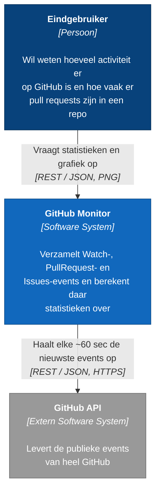
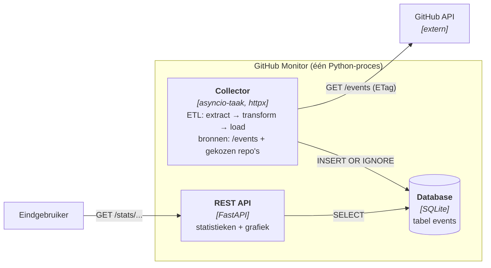

# C4-model, level 1: System Context

> Het C4-model beschrijft software in vier zoomniveaus: **Context → Containers → Components → Code**.
> **Level 1 (System Context)** is het meest uitgezoomde niveau. Het laat zien **wie** het systeem gebruikt en met **welke externe systemen** het praat. Technische details (welke database, welke framework) horen hier nog **niet** bij.

## Toelichting

| Element | Type | Rol |
|---|---|---|
| **Eindgebruiker** | Persoon | Vraagt via de REST API statistieken op: events per type binnen een offset, gemiddelde tijd tussen PR's, en een grafiek |
| **GitHub Monitor** | Ons systeem | Verzamelt de events, slaat ze op en berekent de statistieken |
| **GitHub API** | Extern systeem | Bron van de publieke events (`GET /events`) |

**Kleurgebruik volgens de C4-conventie:** donkerblauw = persoon, blauw = het systeem dat we bouwen, grijs = een extern systeem dat we niet beheren.

## Eén niveau dieper (level 2, ter illustratie)

Niet gevraagd, maar handig voor de presentatie: zo ziet het systeem er van binnen uit.

